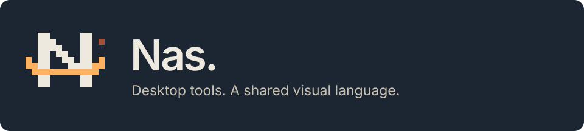
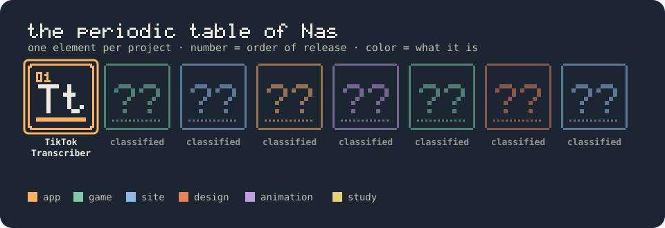
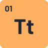

<picture>
  <source media="(prefers-color-scheme: light)" srcset="assets/header-light.svg">
  
</picture>

That orange thing is **Orbi**. He is a small planet with a ring, a moon, and the emotional range of a whole galaxy. He winks, he chases his own moon, he bonks into things, he falls asleep when you ignore him. He is also, somehow, in charge.

I make software that runs **on your computer**, not on someone else's: no accounts, no uploads, no "please sign in to continue". Just a window, your files, and a planet supervising.

## The periodic table of Nas

<a href="https://github.com/nas2077/tiktok-transcriber">
  <picture>
    <source media="(prefers-color-scheme: light)" srcset="assets/table-light.svg">
    
  </picture>
</a>

Every project gets an element: a number (the order it shipped), two letters, and a place in one of the four blocks of the table. Products sit on the left, client work in the middle, experiments on the right, design and study at the bottom. Planets run out. Elements don't.

| | Element | What it does |
|---|---|---|
|  | **[01 · TikTok Transcriber](https://github.com/nas2077/tiktok-transcriber)** | Paste a public TikTok link, get readable transcripts. Recognition runs locally with Qwen and Whisper. Windows, macOS and Linux, in 14 languages. |
| 🔒 | **02 · ???** | Classified. Orbi knows. Orbi isn't telling. |

## Status report

| | |
|---|---|
| 🪐 Planets managed | 1 (he is a lot) |
| 🌙 Moons orbiting the mascot | 1, extremely punctual |
| 🎨 Colors allowed | 6. Ask the design system why. Actually, don't. |
| 🧪 Elements discovered | 01 of ∞ |
| 🐛 Bugs fixed | 999+ |
| 🐛 Bugs written | 1000+ |
| 💤 Orbi's current mood | depends on how long you've been ignoring him |

## Things I believe

- A program should open fast, work offline, and leave your files where you put them.
- Pixel art scales by whole numbers. Always. This is not negotiable.
- If a button needs a manual, the button is wrong.
- Every icon deserves a little planet looking at it approvingly.

 Made by Nas · supervised by Orbi

