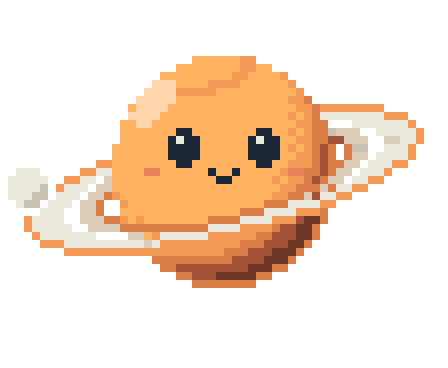

<picture>
  <source media="(prefers-color-scheme: light)" srcset="assets/header-light.svg">
  
</picture>

I build desktop tools and the Nas design system.

My projects share a quiet palette, tactile controls, and pixel art. Each has its own name and mark. The N is my signature; Orbi is the mascot.

**Code:** Python, JavaScript, HTML, CSS.  
**Focus:** local processing, readable output, and interfaces that stay out of the way.

### Syllark

[Readable transcripts from public clips](https://github.com/nas2077/syllark). Local Qwen and Whisper, four integrated choices, and a Windows interface in 14 languages.

### Nas design system

Six core colors, two themes, a small set of components, and motion that respects your preferences. [Explore the catalog](https://nas2077.github.io/nas-design-system/) · [Design notes](DESIGN.md).

[Projects](https://github.com/nas2077?tab=repositories)
